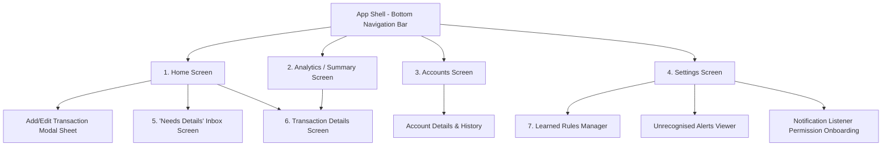
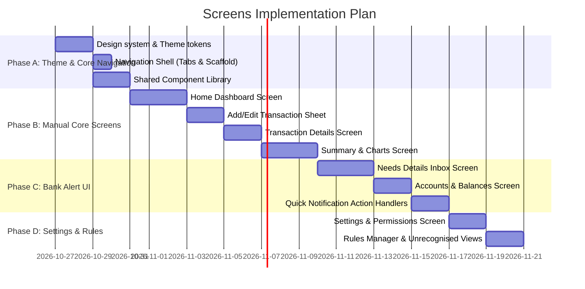

# Kudi Lens — Screens Implementation Plan

> **Scope:** Architecture, UI layout specifications, navigation flow, and phased execution plan for building the complete screen flow in Flutter.

---

## 1. Screen Architecture & Navigation Flow

Kudi Lens uses a bottom navigation shell for top-level exploration, accompanied by modal bottom sheets and sub-page routes for focused tasks (adding transactions, resolving pending alerts, inspecting details).

### Navigation Hierarchy Diagram

---

## 2. Comprehensive Screen Specifications

### Screen 1: Home Dashboard (`HomeScreen`)
The command center of the app. Provides instant financial clarity and highlights actionable items.

* **Header & Balance Glance:**
  * Greeting & current date.
  * **Net Available Balance card:** Aggregated total across tracked bank & MoMo accounts with balance privacy toggle (hide/show eye icon).
  * Quick status chips: Today's spending vs. Yesterday.
* **Alerts Attention Banner (Conditional):**
  * Displayed when pending alerts exist: *"⚡ 3 bank alerts need your input"* with a direct CTA to open the **Needs Details Inbox**.
* **Account Carousel / Horizontal List:**
  * Bank and MoMo cards (e.g. *CalBank Current*, *MTN MoMo Wallet*, *Cash In Hand*).
  * Displays provider logo/badge, masked account number (`140***721`), last reported balance, and timestamp.
* **Recent Transactions Feed:**
  * Grouped by date (Today, Yesterday, Earlier this week).
  * Distinct iconography & color coding:
    * 🟢 **Income** (Emerald)
    * 🔴 **Expense** (Rose/Coral)
    * 🟣 **Bank Fee** (Violet/Purple)
    * 🔵 **Internal Transfer** (Sky Blue)
    * 🟠 **Pending Alert** (Amber with "Needs category" tag)
* **Floating Action Button (FAB):**
  * Elevated `+` button with speed dial / tap to open **Add Transaction**.

---

### Screen 2: "Needs Details" Pending Inbox (`PendingAlertsScreen`)
The heart of the auto-tracking magic. Where raw bank alerts turn into categorized personal records with zero friction.

* **Top Bar:**
  * Count of pending alerts (e.g. *"Needs Details (4)"*).
  * "Clear all dismissed" or batch action icon.
* **Card Items (Newest First):**
  * **Header:** Source badge (e.g. `CalBank SMS Alert` or `MTN MoMo`) + Arrival time (e.g. "12 mins ago").
  * **Amount Display:** Large, high-contrast amount (e.g. `GHS 145.00`).
  * **Raw Narration Box:** Styled pill showing exact info: `Info: CalPay MTN Pull Txn..`.
  * **Quick Tagging Chips:** 4 most likely categories based on rule prediction or common habits (e.g. `[Food]`, `[Transport]`, `[Groceries]`, `[More...]`).
  * **Swipe Actions:**
    * **Swipe Left:** Mark as Transfer / Dismiss.
    * **Swipe Right:** Confirm quick category.
* **Tap Interaction:**
  * Tapping any card opens the pre-filled **Add/Edit Transaction** sheet to adjust details, merchant, or notes.

---

### Screen 3: Add / Edit Transaction (`TransactionFormSheet`)
A modal bottom sheet that handles both manual entries and completing pending alert data.

* **Type Selector:**
  * Segmented tabs: `Expense` | `Income` | `Transfer` | `Fee`.
* **Amount Field:**
  * Massive hero numeric input with currency symbol (`GHS`).
  * Calculator-style input support or formatted decimal keypad.
* **Context Fields:**
  * **Category Picker:** Grid or bottom sheet with rich icons (Food & Dining, Transport, Shopping, Bills & Utilities, Bank Charges, etc.).
  * **Account Selector:** Dropdown/chips to choose account (CalBank, MTN MoMo, Cash).
  * **Merchant / Recipient (Optional):** Searchable or free-text field.
  * **Date & Time Picker:** Defaults to now (or alert timestamp when pre-filled).
  * **Note Field:** Optional user memo.
* **Raw Alert Accordion (If created from alert):**
  * Collapsible panel showing the original raw alert text and balance after for reference.
* **Actions:**
  * Save / Confirm button (with subtle haptic feedback).
  * "Create rule for future alerts" checkbox (when applicable).

---

### Screen 4: Analytics & Summaries (`SummaryScreen`)
Answers *"Where did my money actually go?"* without deceptive transfer inflations.

* **Period Selector:**
  * Pill toggles: `Daily` | `Weekly` | `Monthly` | `Custom Range`.
* **Core Metrics Grid:**
  * **Net Spending:** Total actual expenses (strictly excluding internal transfers).
  * **Total Income:** External deposits and wages.
  * **Hidden Bank Fees:** Dedicated card: *"Bank fees this period: GHS 18.50"* (surfacing SMS fees and transfer levies).
  * **Transfers Total:** Total money hopped between wallets.
* **Category Breakdown:**
  * Donut chart (`fl_chart`) with percentage distribution.
  * Ranked list of categories with spend amounts and progress bars.
* **Pending Notice Banner:**
  * Subtle warning: *"Includes 2 unclassified transactions (GHS 65.00)"* to maintain absolute honesty in totals.

---

### Screen 5: Transaction Details (`TransactionDetailScreen`)
Full audit trail for a single transaction.

* **Hero Section:**
  * Amount, transaction direction, category badge, and status pill (`Confirmed` vs `Pending`).
* **Structured Properties Table:**
  * Date & Exact Time.
  * Account & masked number.
  * Merchant / Counterparty.
  * Location / Channel (e.g. `@BNK`, `Tarkwa POS`).
  * Reported Post-Transaction Balance.
  * Linked Transfer Leg (e.g. *"Linked to MoMo Cash-In #TRX-9482"* with direct link).
* **Source & Raw Alert View:**
  * Card showing verbatim message received from bank/carrier.
  * Hash / ID for deduplication debugging.
* **Actions:**
  * Edit Transaction, Reclassify, or Delete.

---

### Screen 6: Accounts & Balances (`AccountsScreen`)
A dedicated place to manage physical and digital wallets.

* **Account Cards List:**
  * Individual cards with brand accents (CalBank royal blue/gold, MTN MoMo yellow/navy, Cash green).
  * Live bank-reported balance and last reconciliation status (🟢 *Reconciled*, 🟡 *Discrepancy detected*).
* **Account Reconciliation Sheet:**
  * Displays expected balance vs actual balance.
  * Lists any auto-generated *"Unaccounted Gaps"* where alerts were missed by the carrier.
* **Add Account FAB:**
  * Connect manual cash wallet or configure automated bank/MoMo sender templates.

---

### Screen 7: Settings & Intelligence (`SettingsScreen`)
Control privacy, notifications, and the self-learning rules engine.

* **Tracking & Permissions Section:**
  * Auto-track bank alerts (Master Toggle).
  * Notification Listener Permission Status (Active / Requires Action).
  * OEM Battery Optimization Guide (Samsung, Tecno, Infinix, Xiaomi bypass instructions).
* **Smart Engine Management:**
  * **Learned Categorization Rules (`RulesManagerScreen`):**
    * List of active rules (e.g. *"SHOPRITE" → Groceries [Confidence: 98%]*).
    * Ability to edit, disable, or delete rules.
  * **Unrecognised Alerts (`UnrecognisedAlertsScreen`):**
    * Inbox of financial messages that didn't match known templates.
    * "Report format" or "Create custom template" option.
* **Security & Storage:**
  * Encrypted database status (AES-256 via Hive CE).
  * Auto-wipe raw message text after 90 days (toggle).
  * Export Data (JSON / CSV).
  * Wipe All Data.

---

## 3. Design System & Theming Tokens

To ensure a modern, trustworthy, high-contrast fintech aesthetic:

| Token | Dark Theme Value | Light Theme Value | Usage |
|---|---|---|---|
| `bgPrimary` | `#0B0F19` (Deep Navy Black) | `#F8FAFC` (Cool Off-White) | App Background |
| `bgSurface` | `#151C2C` (Elevated Navy) | `#FFFFFF` (Pure White) | Cards & Bottom Sheets |
| `brandPrimary` | `#3B82F6` (Electric Blue) | `#2563EB` | Primary buttons, active tabs |
| `accentIncome` | `#10B981` (Emerald) | `#059669` | Income, positive balances |
| `accentExpense` | `#F43F5E` (Rose Coral) | `#E11D48` | Expense amounts |
| `accentFee` | `#8B5CF6` (Bright Violet) | `#7C3AED` | Bank fees & levies |
| `accentTransfer`| `#0EA5E9` (Vivid Sky) | `#0284C7` | Inter-wallet transfers |
| `accentPending` | `#F59E0B` (Warm Amber) | `#D97706` | Needs details / alerts |

---

## 4. Phased Implementation Roadmap

### Detailed Breakdown

#### Phase A: Foundation & Reusable UI Components
- Define `AppTheme`, color schemes (Dark & Light), typography, and dimensions.
- Create atomic components:
  - `TransactionTile`: Dynamic iconography, direction styling, swipe-to-action.
  - `BalanceCard`: Masked digits, gradient background, toggle visibility.
  - `CategoryBadge`: Micro-chip with icon and color.
  - `EmptyStateWidget`: Clean illustrations when no pending alerts or transactions exist.
- Build root `NavigationShell` with smooth tab transitions.

#### Phase B: Core Manual Screens
- Implement `HomeScreen` with dummy/mock state first, wired to Riverpod providers.
- Implement `TransactionFormSheet` modal with category picker grid and numeric keypad.
- Implement `TransactionDetailScreen` with source badges and linked transaction slots.
- Implement `SummaryScreen` featuring `fl_chart` donut and bar graphs.

#### Phase C: Bank Alert Tracking UI
- Build `PendingAlertsScreen` ("Needs Details" Inbox) with swipe-to-categorize and quick-chip actions.
- Build `AccountsScreen` with live balance reconciliation indicators.
- Wire local notification tap handlers to directly pop open the matching transaction sheet.

#### Phase D: Settings, Rules Engine & Polish
- Build `SettingsScreen` with notification listener permission guide.
- Build `RulesManagerScreen` to allow users to view and delete auto-learned categorization rules.
- Build `UnrecognisedAlertsScreen` to inspect raw unparsed alerts.
